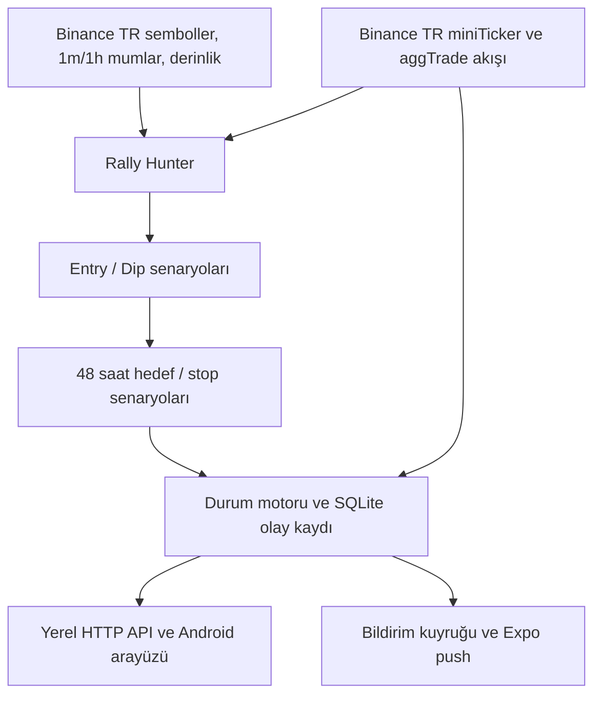

> Bu dosya kaynak MVP mimarisinin arşividir. Bağımsız Lab sürümünün güncel mimarisi: [docs/LAB_ARCHITECTURE.md](docs/LAB_ARCHITECTURE.md).

# Oran Radar — sistem tasarımı ve kapsam

## Karar ve veri akışı

**Fiyat otoritesi:** bütün limit, hedef, stop, sanal gerçekleşme ve sonuçlar Binance TR spot TRY pariteleriyle hesaplanır. Sembol listesi `/open/v1/common/symbols`; mumlar `api.binance.me/api/v1/klines`; derinlik `api.binance.me/api/v3/depth`; bütün piyasa mini ticker ve seçili paritelerin aggregate trade akışı `stream-cloud.binance.tr`. İlk sürüm resmi listede `type=1`, spot aktif, TRY kotasyonlu ve geçerli tick filtresine sahip pariteleri kapsar. İkinci sembol altyapısına ait pariteler ek adaptör gerektirir.

**Seçim:** TRY ile fiyatlanan stabil varlıklar çıkarılır; 24 saatlik TRY hacmi en az 1 milyon TL olan pariteler sıralanır. Varsayılan üst 20 parite her 5 dakikada incelenir. İlk ekran, incelenenlerden en yüksek 10 puanlı adayı gösterir. Akış anlık fiyatı gösterir, fiyat temasına dair sonuç için yalnızca aggregate trade kaydı kullanılır.

**MVP skor bileşenleri:** 24 saatlik trend, son yükseğe yakınlık, dakikalık hacim oranı, saatlik sıkışma, ilk 10 defter kademesinin alış payı, BTC/TRY bağlamı. Aynı sinyal grubundan çok sayıda indikatör toplanmaz. Başka değişkenler yokmuş gibi puanlanmaz; OI, funding, vadeli, on-chain ve haber alanları henüz bağlı değildir. Bu puanın istatistiksel tahmin gücü henüz gösterilmedi.

**Geçici olasılıklar:** 1 saatlik en çok 1.000 kapalı mumdan her 24 saatte bir giriş penceresi ve her 56 saatte bir giriş+48 saatlik çıkış penceresi oluşturulur. Geçmiş pencerenin başlangıç fiyatına aynı oransal seviyeler uygulanır. Jeffreys düzeltmeli gözlem oranları 2/6/12/24 saatlik girişi, 6/12/24/48 saat hedefi, hedefin stoptan önce görülmesini ve stopun hedeften önce görülmesini verir. Tek mumda hedef ve stop birlikte görülürse stop önce kabul edilir. Hedef için en az 12 bağımsız tarihsel işlem örneği yoksa oran `null` olur. Bu oranlar **geriye dönük baz oranlarıdır**; aday seçimi, parametre ayarı ve model değerlendirmesi için ayrı dönem gerektirdiğinden kalibre edilmiş olasılık sayılmaz.

**Giriş kararı:** puan, hacim, spread, tarihsel giriş/hedef sıklığı ve masraf sonrası beklenti birlikte değerlendirilir; uygun aday yoksa ENTRY oluşmaz. WATCH, SCOUT ve SETUP görüntülenebilir. Paper ENTRY aynı paritede ikinci kez açılmaz; son 12 saat içinde üretilmiş sinyal yeniden önerilmez. Giriş penceresi 8 saattir. Limit fiyat tick boyuna aşağı, hedef tick boyuna yukarı yuvarlanır.

**Gerçekleşme semantiği:** `ENTRY HIT` diye bildirilen olay Binance TR'deki bir **işlemin** önerilen limite eşit veya daha düşük fiyat göstermesidir. Bu gerçek kullanıcının limit emrinin işlem gördüğünü kanıtlamaz. Sanal miktar varsayılan 1.000 TRY, alış fiyatı önerilen limit kabul edilir. Bundan sonraki ayrı bir trade hedefe/stopa dokunduğunda sonuç oluşur. 48 saat, giriş seviyesine dokunulan işlem zamanında başlar. Süre bittiğinde ilk sonraki işlem fiyatı kapanış vekili olur. Trade ID boşlukları REST aggTrades ile sırayla tamamlanır; tamamlanamazsa çift taraflı olay kararı bekletilir ve health ekranında parite bloklu görünür.

## Veritabanı

SQLite WAL, tek süreçli MVP için kullanılır. `opportunities`: son puan, seviye, özellikler, kaynak zamanı. `signals`: benzersiz UUID, parite, başlangıç fiyatı, giriş/son geçerlilik, hedef, stop, skor, olasılıklar, net beklenti, model sürümü, rejim, özellik snapshot'ı, sanal tutar ve masraf varsayımı, durum, sonuç, doldurma/kapanış zamanları, gözlenen fiyatlar. `events`: append-only durum olayları ve trade ID. `feed_state`: parite başına son işlenen trade ID, piyasa zamanı ve alınma zamanı. `devices` ve `notifications`: Expo token ve gönderim kuyruğu.

Yalnızca bir açık sinyale izin veren kısmi benzersiz indeks vardır. Tekrarlanan aggregate trade olayları işlem ID/zamanıyla filtrelenir. Her sinyal yalnızca `SUCCESS`, `STOPPED`, `ENTRY_NOT_FILLED`, `TIME_EXPIRED`, `CANCELLED` sonuçlarından biriyle kapanır. WATCH/SCOUT/SETUP aday durumları sinyal kaydından ayrı tutulur. Bu ilk sürümde BOUGHT ve TARGET ACTIVE olayları aynı trade'de art arda kaydedilir.

## Sunucu ve Android

Sunucu Python 3.11+; HTTP API standart kütüphane, websocket istemcisi `websockets`, SQLite kalıcı veri, arka planda asyncio akışı ve tarama. `/health`, `/opportunities`, `/signals`, `/history`, `/signals/{uuid}`, `/market?pair=`, `/candles?pair=`, `/metrics`, `POST /devices`. Android Expo/React Native: Radar, Aktif, Geçmiş, Performans sekmeleri; seviye çizgili 1 dakikalık grafik; olay kaydı; sunucu adresi; isteğe bağlı push kaydı. Telefon kapalıyken sunucu süreci çalışmalıdır.

Bildirimleri uygulamanın sunucusu kuyruğa alıp Expo Push Service üzerinden iletir. Android üzerinde uzaktan push için FCM yapılandırılmış native Android build ve EAS project ID gerekir. Kuyruk varsayılan olarak kapalıdır; telefon ve altyapı kurulduktan sonra açılır. Birden fazla cihaza kısmi dağıtımda tam tekrar önleme, fiş/receipt takibi ve sunucu kimlik doğrulaması üretim işi olarak kalır.

## APK cihaz modu (v1.0.1)

İlk açılışta kayıtlı sunucu yoksa Android doğrudan Binance TR public mini ticker akışını kullanır. Resmi sembollerle filtrelenmiş, minimum 1 milyon TRY hacimli paritelerin en likit 20 tanesi 120 kapalı saatlik mum, 121 dakikalık mum ve defter derinliğiyle taranır. Ön skor backend skorunun aynı altı grup ağırlığını kullanır; yalnızca WATCH/SCOUT gösterir. ENTRY, hedef olasılığı veya kalıcı paper sonuç üretmez. Arka plana geçince cihaz bağlantısı kapanır; yeniden açılınca bağlanır. Sunucu adresi bağlandığında backend sinyalleri/sonuçları kullanılır. Ağ hatalarında son fiyat gözlemleri canlı diye etiketlenmez. HTTP istekleri süre aşımıyla sonlandırılır; 429/418 yanıtlarında REST taraması durdurulur.

APK Expo SDK 57 / React Native 0.86 üzerinde release olarak paketlenir; Metro gerekmez. Android paket kimliği `com.oranradar.paper`, sürüm `1.0.1`, versionCode `2`, minSDK `24`, targetSDK `36`. Benzersiz RSA imzalama anahtarı kaynak koddan ayrı yedeklenir. İstenmeyen mikrofon, harici depolama ve overlay izinleri manifestte engellenir.

## Modelin sonraki aşaması

1. Parite başına tam olay kaydı, dondurulmuş özellik şeması, borsa saatine göre izlenebilir veri seti ve işlem/kayma maliyetiyle geçmiş toplama.
2. Zaman bazlı train/validation/test, embargo (en az giriş+48 saat), purged walk-forward; özellik aileleri için ablation; BTC ve rejim koşulları. Liquidite ve haber verisini sinyal anındaki yayın zamanına göre join.
3. Rally sınıflandırıcısı (LightGBM/XGBoost), entry dokunma ve competing-risk hedef/stop sağkalım modelleri, rejim sınıflandırıcısı ve order-flow modeli. LLM sadece açıklama/metin özetler.
4. Ayrı dönem üzerinde kalibrasyon (isotonic/Platt), Brier score, güven aralıkları ve rejim dilimleri. Sinyal karar eşiği gerçek işlemde forward cohort ile belirlenir; yeni model champion'ı out-of-sample geçmeden devreye alınmaz.
5. PostgreSQL/TimescaleDB, durable queue, çoklu feed, sembol türü 3 adaptörü, telefon kimlik doğrulaması, TLS, izleme, gap alarmı, trade maliyetine duyarlı portföy performansı.

## Temel metrikler ve sınırlar

`/metrics` tamamlanan forward paper sinyallerden giriş görülme, hedef, stop, süre dolma, net ortalama/medyan, profit factor, sıralı sanal işlem getirilerinden düşüş ve 10 puanlık tahmin kalibrasyon kovalarını üretir. Bunlar gerçek portföy Sharpe/drawdown değerleri değildir. Emir sırası, dolan miktar, borsa fiyat bandı, ücret indirimi ve satış emri likiditesi simüle edilmemiştir. Doğrulanmış başarı iddiası için birkaç yüz **ileri dönük, bağımsız** sinyalin ve ayrı bir test döneminin sonucu gerekir.
