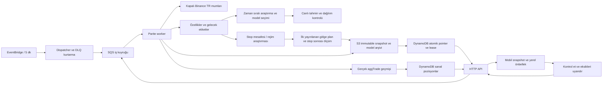

# Bağımsız backend mimarisi

## Süreklilik ve yayın

`scheduled` frontend olmadan çalışır. Kaynak sayfaları ve manuel işlem geçmişi istekleri sınırlıdır; checkpoint'ten sonraki işte devam edilir. Mumlarda sayfa içi/sayfalar arası boşluk, sıra bozukluğu, açık mum, geçersiz OHLCV veya gelecek timestamp kabul edilmez. Worker başarısız olursa en son iyi yayın korunur ve hata audit'e yansır.

Parite başına lease kullanılır. Payload S3'e önce yazılır; ancak halen geçerli lease sahibi DynamoDB pointer'ını güncelleyebilir. Süresi geçmiş worker yeni worker'ın sonucunu ezemez. Kısmi SQS yanıtı hatalı mesajları retry için bırakır. Başarısız optimizasyon adayları üretime alınmaz. Her job sonucu aşama durumu taşır: acquisition, features, labels, research, forward_monitor, paper_tracking, publication.

Backend 2.1 ayrıca `stop_research` ve `stop_forward_monitor` aşamalarını denetler. Eksik/eski stop araştırması ve gölge veri boşlukları kontrol düğmesinin kurtarma kapsamındadır. Gerçek işlem takip bütçesi stop sonrası hedefe dönüş takibini de kapsar. Stop karşılaştırmaları aynı immutable state/pointer ile yayınlanır; ilk planlar ve kümülatif sayaçlar atomik commit içinde kalır. Yöntem/retention [STOP_LOSS.md](STOP_LOSS.md).

`GET /health` yalnızca protokol/yetenek bilgisi verir. Derin kontrol `GET /v2/audit` içindedir. Düğme `POST /v2/control/reconcile` ile eksik pariteleri kuyruklar; 202 kabul yanıtıdır, bitiş belgesi değildir. UI sonraki snapshot'ta gerçek durumu tekrar doğrular. Zamanlayıcı, veri kaynağı veya erişim yetkisi arızaları gerektiğinde işletim tarafında giderilmelidir.

## API

`/health` hariç uçlar bulutta Bearer token ister; token yoksa cloud handler 503 döndürür. Yerel geliştirmede token isteğe bağlıdır.

| Uç | Davranış |
|---|---|
| `GET /v2/snapshot` | schema_version=2, kontrol, parite snapshot'ları ve sanal pozisyonlar |
| `GET /v2/audit` | Güncel iş/mum/model/aşama, lease, zamanlayıcı ve işlem boşluğu kontrolü |
| `POST /v2/control/reconcile` | Eksikleri tekrar başlatır; 202 ve önceki audit |
| `GET /v2/research?pair=BTCTRY&offset=0` | Kanıt tablosu, 100 satırlık sayfalar |
| `GET /v2/forward?pair=BTCTRY&offset=0` | İlk yayınlanmış tahmin/sonuç günlüğü, 100 satırlık sayfalar |
| `GET /v2/stop-loss?pair=BTCTRY` | Aday stop mesafeleri, gereken/etkin n, tarihsel/ileri/manuel ölçüm |
| `GET /v2/stop-loss/research?pair=BTCTRY&offset=0` | Tüm stop/ufuk/rejim karşılaştırmaları |
| `GET /v2/stop-loss/forward?pair=BTCTRY&offset=0` | Gölge plan/sonuç günlüğü |
| `GET /pairs` | Yapılandırılmış TRY izleme listesi ve son gözlenen fiyatlar |
| `GET/POST /paper-positions` | UUID ile idempotent manuel sanal kayıtlar |
| `GET /market?pair=BTCTRY` | Ayrı araştırma sonucu; trade fırsatı gibi gösterilmez |
| `GET /candles?pair=BTCTRY` | Son 120 saatlik kapalı mum |

Legacy `/opportunities`, `/signals`, `/history` yeni yön araştırmasını trade sinyali gibi sunmamak için boş döner. Manuel sanal işlemler aktif/geçmiş ekranlarında korunur. Push kayıt ucu 501 ile açıkça yapılandırılmadığını bildirir.

## Frontend veri sözleşmesi

Mobil API yeteneklerini doğrular ve v2 snapshot'ına geçer. Her parite sonucu kendi atomik revision/as_of değerini taşır; farklı pariteler tek piyasa anında tamamlanmış gibi gösterilmez. Eski sonuç önbelleği API adresiyle ayrılır, ağ hatasında korunur ve güncelliği doğrulanmamış olarak gösterilir. Yeniden açılış ve aktif polling yenileme yapar. Source `SYNTHETIC_DEMO` olduğunda canlı veri olmadığı yazılır.

Frontend kendi kapalı uygulama sürecini açık tutmaya çalışmaz; kalıcı işlev buluttadır. Veri frekansı saatlik, job denetimi 5 dakikalık, aktif uygulama yenilemesi 15 saniyeliktir. Tick düzeyinde canlı fiyat veya anında gerçek emir yürütme vaat edilmez.

## Yeni istatistik/kaynak ekleme

Temel özellikler `features.BASE_NAMES`/`base_at` ile tanımlanır; gecikmeler otomatik çoğaltılır, yeni özellik test/kanıt ailesine katılır. Geleceğe bakmama testi yeni özellikler için de geçerlidir. `research` eğitimden seçilen özellik çiftlerini her turda yeniden önerir; kullanıcı sürekli elle kombinasyon yazmak zorunda değildir.

Yeni bir veri adaptörü aynı closed-candle sözleşmesini sağlamalıdır. OHLCV dışı order book/funding/haber gibi veriler ancak **o anda** alınmış, source/as_of taşıyan kalıcı gözlemlerden point-in-time join ile eklenmelidir. Bugünün order book'u geçmiş yıllara kopyalanmamalıdır. Yeni özellikler eklenince model schema ve araştırma protokolünü sürümleyin; eski ağırlıkları farklı kolon düzenine uygulamayın.

Bu sürüm tek kullanıcı/özel token ve sınırlı izleme listesine yöneliktir. Daha büyük ortamda kimlik bazlı kullanıcı ayrımı, pozisyon indeksleri, dataset parçalaması, kısa/uzun işlerin ayrı kuyrukları ve maliyet ölçümü gerekir. AWS kaynakları deploy edilmeden bu ortamın kapanışından sonra sürekli iş garanti edilmez.
